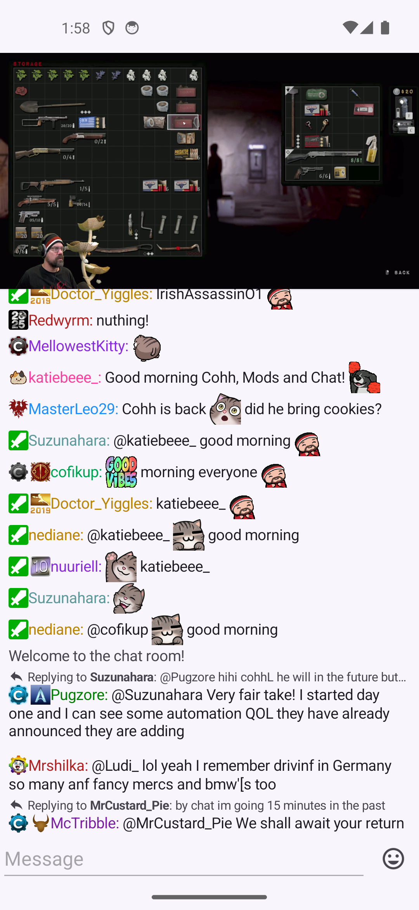
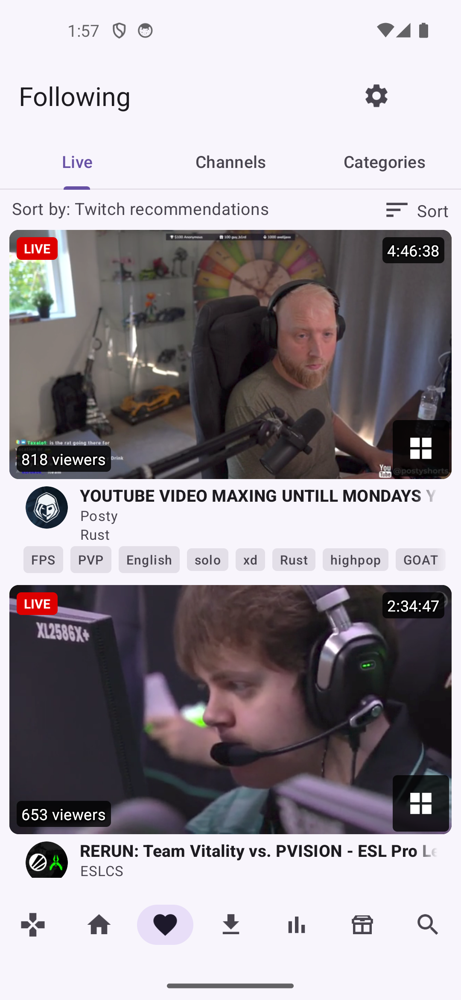
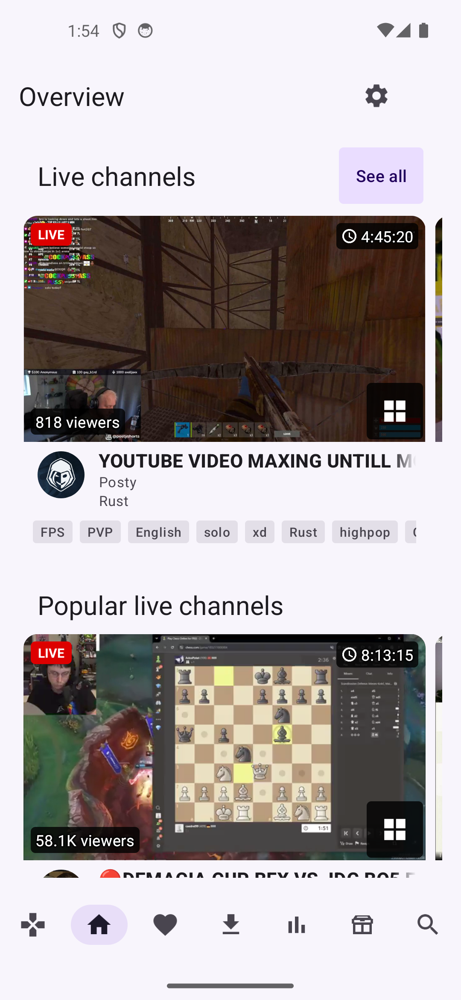
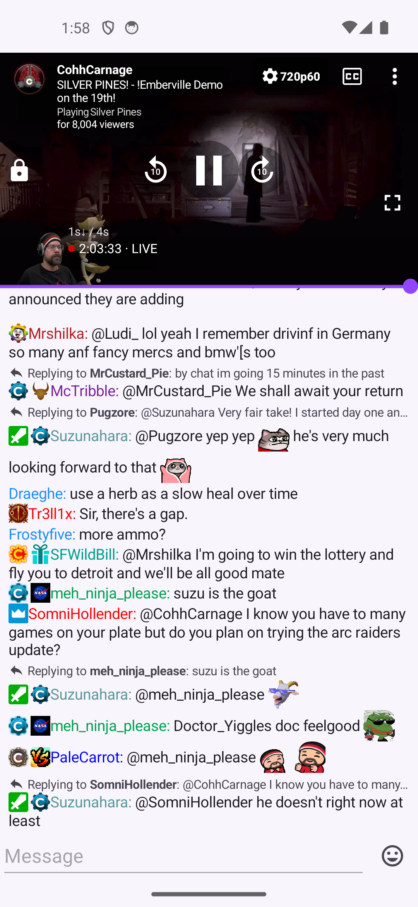
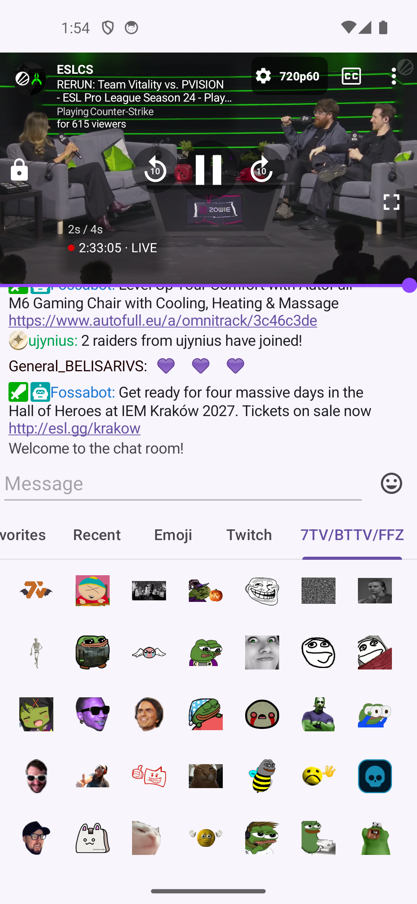
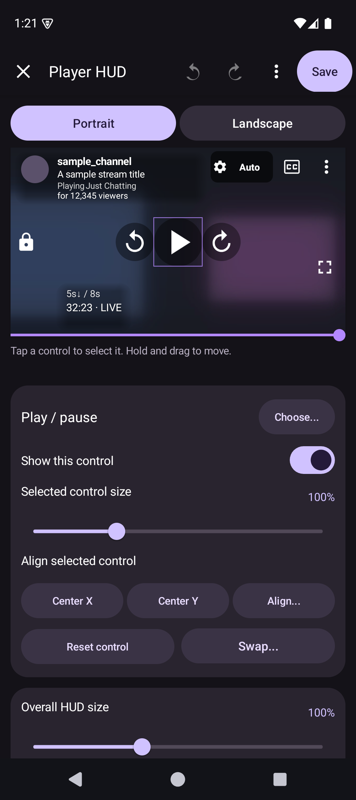
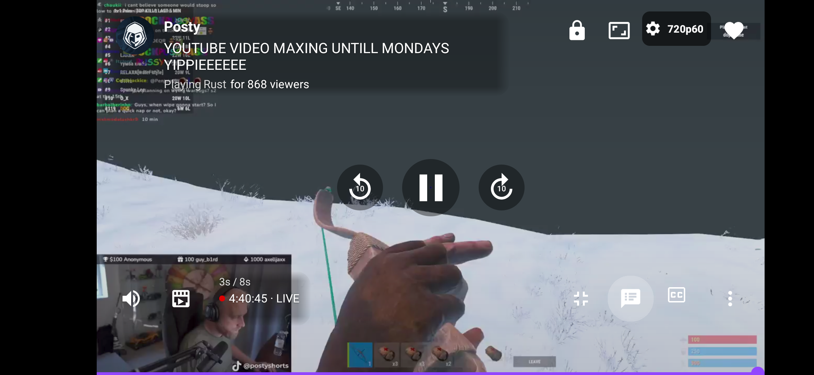
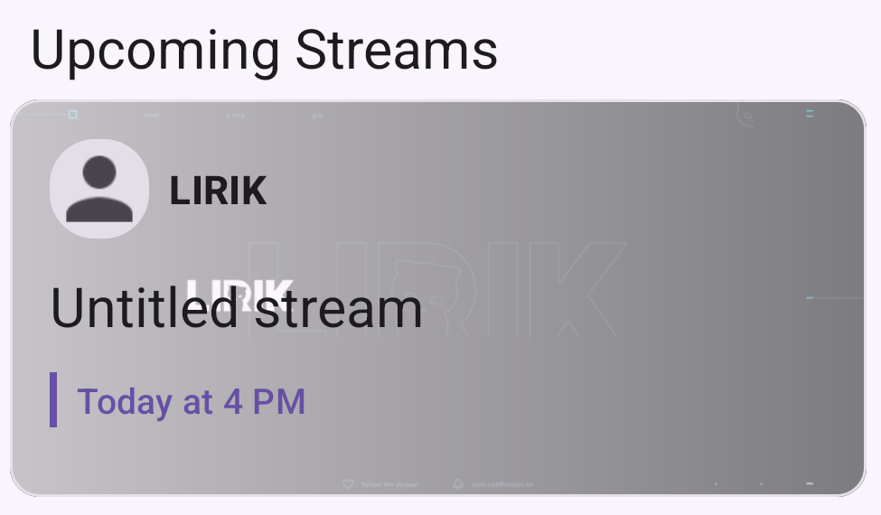

# Xtra for Twitch

  

This is my fork of [Xtra](https://github.com/crackededed/Xtra), a Twitch app for Android. I've added live rewind, an editable player HUD, Channel Points, viewing statistics, and a reworked Overview page.

[Download the latest version](https://github.com/thiscallnet/Xtra/releases/latest)

## Screenshots

  
  
  

  
  
  

  
   
  

## Features

- Live streams, past broadcasts, clips, and video downloads for offline watching.
- Live rewind when the stream has a recording. Go back to something you missed, then return to live.
- Background audio and playback with the screen off. Picture-in-picture can also show read-only live chat. Cast is supported too.
- A player HUD you can move, resize, and hide controls in, with separate portrait and landscape layouts. Swipe controls for brightness and volume, plus a sleep timer.
- Twitch, 7TV, BetterTTV, and FrankerFaceZ emotes, with search, favorites, and recent emotes. Replies and moderator tools are supported.
- Channel Points, rewards, watch streaks, polls, predictions, and Drops progress.
- Overview shows live channels, recent videos, upcoming streams, and recently offline channels. Search remembers the channels and categories you open.
- Compact cards, adjustable grids, themes, chat appearance, and navigation settings. Settings have search too.
- Viewing statistics stored on your device, and backups for settings and local data.
- Live notifications with battery saving, fast, and persistent real-time modes.
- Experimental live captions for English speech, optional alternate streams during ad breaks, and update checks with release notes in the app.

## Download

Requires Android 8.0 or newer.

Open the [latest release](https://github.com/thiscallnet/Xtra/releases/latest) and download the APK for your device. Most recent phones use **arm64-v8a**. Open the file to install it, and allow installation from your browser or file manager if Android asks.

Sign in to use your Twitch follows, send chat messages, and access Channel Points and other account features. You can also follow channels locally without an account.

## Notes

- Live rewind needs an available recording. Captions are experimental, and alternate-stream quality and availability can vary.
- Persistent real-time mode keeps an ongoing notification visible. Android's battery restrictions can still delay live alerts.
- Poll results are saved after Xtra observes them. A poll that finishes while Xtra is closed may be unavailable.
- Backups include local history and statistics, but not downloaded media or logins.

## Community and credits

[Discord](https://discord.gg/2cKy8DNgPX) | [Report an issue](https://github.com/thiscallnet/Xtra/issues)

Xtra is free and open source, licensed under the [GNU Affero General Public License v3.0](LICENSE).
